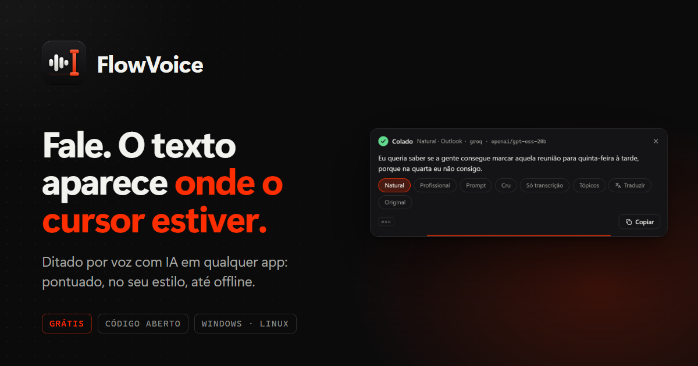

<div align="center">

# FlowVoice

**Ditado por voz com IA em qualquer app.**

[](https://github.com/cesarkali/Flow-Voice/releases/latest)
[](LICENSE)

[Baixar](https://github.com/cesarkali/Flow-Voice/releases/latest) · [Site](https://flowvoice.caliberda.com.br) · [Guia](https://flowvoice.caliberda.com.br/guia) · [Privacidade](https://flowvoice.caliberda.com.br/privacidade)



</div>

Aperte um atalho, fale, e o texto aparece onde está o cursor: limpo, pontuado e no estilo que você escolher. O FlowVoice fica na bandeja do sistema, funciona em qualquer aplicativo (e-mail, chat, editor, navegador) e usa chaves de API **gratuitas** (Groq, Gemini, OpenRouter, Mistral) ou modelos Whisper que rodam **100% offline** no seu PC. Para Windows 10 e 11.

## Recursos

- **Ditado em qualquer lugar**, com o texto aparecendo ao vivo no overlay enquanto você fala. Modo alternar ou segurar para falar (push-to-talk); `Esc` cancela.
- **Estilos de IA**: *Natural*, *Profissional*, *Prompt* (enxuga a fala para mandar a uma IA, com menos tokens e o mesmo contexto), *Cru* e *Só transcrição*. Prompts editáveis e estilos próprios.
- **Tradução para 34 idiomas**, por atalho ou com um clique no overlay depois do resultado.
- **Modo Comando**: selecione um texto em qualquer app e diga o que fazer com ele ("resuma", "deixe mais formal").
- **Estilos por aplicativo**: Profissional no Outlook, Natural no Slack, Prompt no VS Code; apps web (Gmail, WhatsApp Web, ChatGPT…) são reconhecidos pela aba do navegador.
- **Assistente por voz**: faça uma pergunta falada e receba a resposta num chat; com uma chave Tavily, busca na web e cita as fontes.
- **Chaves grátis com rotação automática**: cadastre várias chaves e provedores; se um estourar o limite ou falhar, o próximo assume.
- **Modelos que se corrigem sozinhos**: quando um provedor aposenta um modelo, o FlowVoice encontra, testa e salva o substituto.
- **100% offline** com whisper.cpp: modelos de 31 MB a 547 MB baixados sob demanda, incluindo um *Distil Large v3* ajustado para português do Brasil. Para refinar sem internet, use o Ollama.
- **Chaves no cofre do sistema** (Gerenciador de Credenciais do Windows), nunca em texto puro.
- Vocabulário próprio, remoção de vícios de linguagem ("né", "tipo", "hã"), histórico pesquisável, colar de novo a última transcrição, interface em PT/EN/ES, tema claro e escuro.
- **Leve**: instalador de ~3 MB, sem pedir administrador, com **atualização automática** assinada.

## Download

**Windows 10/11:** baixe o [`FlowVoiceSetup.exe`](https://github.com/cesarkali/Flow-Voice/releases/latest/download/FlowVoiceSetup.exe) (também publicado como `FlowVoice_x.y.z_x64-setup.exe`) em **[Releases → última versão](https://github.com/cesarkali/Flow-Voice/releases/latest)**. Não precisa de administrador. Na primeira execução, a 2.0 importa automaticamente as chaves salvas pela 1.x.

## Atalhos padrão

| Ação | Atalho |
|---|---|
| Ditar (começa e para) | `Ctrl + Shift + Espaço` |
| Ditar já traduzindo | `Ctrl + Shift + Y` |
| Assistente por voz | `Ctrl + Shift + U` |
| Comando sobre o texto selecionado | `Ctrl + Alt + K` |
| Colar de novo a última transcrição | `Ctrl + Alt + V` |
| Cancelar a gravação | `Esc` |

Todos podem ser trocados em **Configurações**. Para Stream Deck, AutoHotkey ou scripts, a linha de comando controla o app já aberto: `FlowVoice.exe --toggle` (também `--translate`, `--ask`, `--command`, `--paste-last`, `--cancel`).

## Começo rápido

1. Instale e abra o FlowVoice (ele fica na bandeja).
2. Crie uma chave grátis do **Groq** em [console.groq.com/keys](https://console.groq.com/keys).
3. Cole a chave em **Provedores** e clique em **Testar**.
4. Coloque o cursor em qualquer campo de texto, aperte `Ctrl + Shift + Espaço`, fale e aperte de novo.

O [guia completo](https://flowvoice.caliberda.com.br/guia) explica cada provedor (Groq, Gemini, OpenRouter, Mistral, OpenAI, Ollama, Tavily), o modo offline e os estilos.

## Privacidade

Sem conta, sem servidor próprio e sem telemetria. No modo nuvem, o áudio e o texto vão direto do seu PC para o provedor que **você** configurou, com a sua chave; no modo local, nada sai do computador. As chaves ficam no cofre de credenciais do sistema. Detalhes em [flowvoice.caliberda.com.br/privacidade](https://flowvoice.caliberda.com.br/privacidade).

## Desenvolvimento

Stack: **Tauri 2** (Rust) + **Svelte 5** + Vite. Transcrição local com [whisper.cpp](https://github.com/ggml-org/whisper.cpp) via `whisper-rs`.

**Requisitos**

- Node 22 e Rust estável.
- Visual Studio Build Tools (C++ e CMake), **Ninja** e **LLVM** (`libclang`, para o bindgen do whisper.cpp). Se o LLVM não estiver no lugar padrão, defina `LIBCLANG_PATH` para a pasta com `libclang.dll`. O Ninja é obrigatório na prática: sem ele o whisper.cpp compila sem otimização (veja `src-tauri/.cargo/config.toml`).
- O código tem caminhos para Linux, mas a versão para Linux ainda não é suportada.

**Comandos**

```bash
npm ci               # dependências
npx tauri dev        # app completo, com recarga ao vivo
npm run dev          # só a interface no navegador, com dados simulados
npm run check        # svelte-check
npx tauri build      # instalador (.exe)
```

**Estrutura**

| Caminho | Conteúdo |
|---|---|
| `src/settings`, `src/overlay`, `src/chat` | as três janelas em Svelte (configurações, overlay de gravação, chat do assistente) |
| `src/lib` | componentes, i18n (PT/EN/ES), tipos e ponte com o Rust |
| `index.html`, `overlay.html`, `chat.html` | entradas do Vite, uma por janela |
| `src-tauri/src` | núcleo em Rust: áudio, whisper local, nuvem, pipeline, atalhos, colagem, bandeja |
| `src-tauri/tauri.conf.json` | janelas, instalador (NSIS) e atualizador |
| `website/` | site estático [flowvoice.caliberda.com.br](https://flowvoice.caliberda.com.br) |
| `.github/workflows/release.yml` | build e publicação do instalador |

## Publicar uma versão

1. Atualize a versão em `package.json`, `src-tauri/Cargo.toml` e `src-tauri/tauri.conf.json`, e descreva as mudanças no [CHANGELOG](CHANGELOG.md).
2. Uma única vez: cadastre os secrets `TAURI_SIGNING_PRIVATE_KEY` (chave privada do atualizador) e `TAURI_SIGNING_PRIVATE_KEY_PASSWORD` no repositório.
3. Crie e envie a tag:

   ```bash
   git tag vX.Y.Z && git push origin vX.Y.Z
   ```

   O GitHub Actions gera o instalador assinado para Windows, o `latest.json` do atualizador e um release em rascunho. Revise e publique.

## Apoie o projeto

O FlowVoice é gratuito. Se ele te ajuda, considere apoiar: **Pix** em [livepix.gg/caliberda](https://livepix.gg/caliberda) ou [GitHub Sponsors](https://github.com/sponsors/cesarkali).

## Créditos e licença

Feito por **Júlio Caliberda** · [github.com/cesarkali](https://github.com/cesarkali) · [caliberda.com.br](https://caliberda.com.br)

Licença [GPL-3.0](LICENSE): você pode usar, estudar, modificar e redistribuir o FlowVoice, desde que qualquer versão distribuída vá junto com o código-fonte completo, sob a mesma licença e com os créditos.

O projeto não aceita pull requests; problemas e ideias vão pelas [issues](https://github.com/cesarkali/Flow-Voice/issues) (veja [como contribuir](CONTRIBUTING.md)). Falhas de segurança: [SECURITY.md](SECURITY.md).
